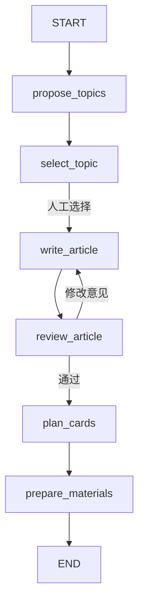

# LangGraph 自媒体内容工作流

一个围绕 LangGraph 1.0 的最小 Python 框架，重点展示状态、节点、路由和人工中断。



## 运行

```powershell
cd backend
uv sync
uv run uvicorn media_ops.main:app --host 127.0.0.1 --port 8000
```

打开 [Swagger](http://127.0.0.1:8000/docs)，按下面顺序调用：

1. `POST /runs`，请求体 `{}`，返回 run_id、选题和中断信息。
2. `POST /runs/{run_id}/resume`，请求体 `{"topic_index": 0}`，生成文章并等待审核。
3. 同一 resume 接口提交 `{"decision": "revise", "feedback": "增加入门案例"}`，重写后再次等待审核，可重复多轮。
4. 提交 `{"decision": "approve"}`，生成 3–5 张图片的内容规划及小红书、公众号内容。
5. `GET /runs/{run_id}` 查看状态、下一节点和中断。

## 代码入口

```text
backend/src/media_ops/
  state.py       TypedDict 共享状态
  provider.py    内容生成接口与 mock
  workflow.py    StateGraph 节点、边、interrupt、Command
  api.py         启动、查询、恢复三个接口
  main.py        服务入口
```

建议先读 workflow.py，再看 state.py 和 provider.py。FastAPI 只负责把人工输入交还给图。

当前内容全部为 mock，图片阶段只输出内容规划，不生成真实图片。InMemorySaver 仅在单进程内保存状态，服务重启会丢失流程；示例无鉴权、并发控制、自动发布，适合本地单用户学习。旧 data 目录保留，但不会读取旧业务数据。新接口与原接口不兼容。

```powershell
cd backend
uv run pytest -q
```

框架细节见 [工作流说明](docs/workflow.md)；后续扩展见 [技术方案](技术方案.md)。
