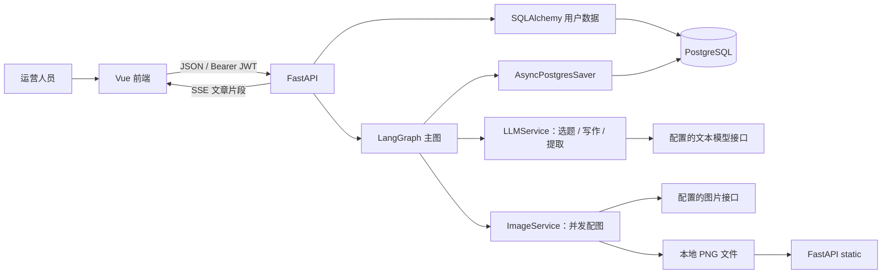
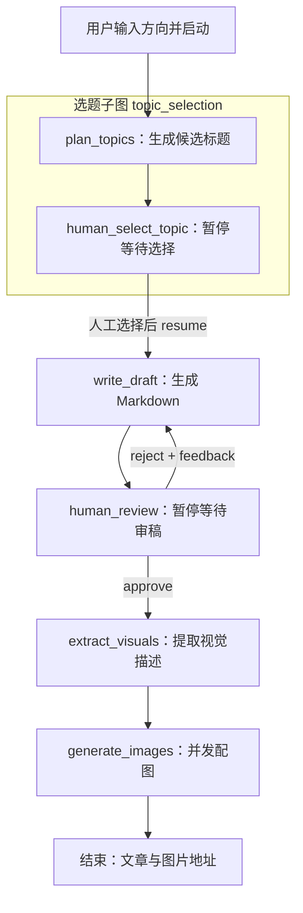

# AI 自媒体内容运营助手：当前技术方案

更新时间：2026-11-03。依据当前 `graph_xiaohongshu/` 源码整理；本文描述代码已有的实现，不把框架支持或未来规划写成项目成果。本次为静态代码核对，未连接数据库和付费模型做运行验收。

学习顺序：先读本文理解整体，再读 [简历重点理解](./简历重点理解.md) 中的注释代码和面试问答；可用于简历的精简表述见 [简历项目描述](./简历项目描述.md)。

## 1. 项目在解决什么问题

运营人员想持续发布人工智能、机器人等方向的内容。手工流程通常是：想选题、写文章、审稿、整理配图、保存素材。本项目把这些步骤串成可暂停、可继续的工作流。

AI 负责生成，人工负责选题和文章确认。审核未通过时，反馈重新进入写作节点；通过后提取视觉描述，调用图片服务生成配图。

**当前交付的是“内容生产工具”，并非自动发布或自动增长系统。** 没有平台用户行为采集和真实热点排序；没有小红书、公众号自动发布接口。

### 当前实现范围

| 能力 | 当前代码事实 |
| --- | --- |
| 注册、登录 | 已有用户模型、数据库访问、密码散列与 JWT 认证 |
| 选题 | LLM 生成候选标题；提示词要求 5 个，但 Schema 未严格约束数量 |
| 人工选题 | 选题子图内用 interrupt 暂停，恢复后进入写作 |
| 写作、审稿 | 生成 Markdown；可通过或携带反馈驳回，再次写作 |
| 文章流式输出 | 选择选题或驳回时，可使用 SSE 获取模型文本片段 |
| 图片 | 提取至多 3 条视觉描述，异步并发请求图片接口；本地保存 PNG 并返回静态 URL |
| 状态保存 | 主图接入 AsyncPostgresSaver；提供当前状态和历史快照查询 |
| 指标与日志 | 节点耗时、Token、模型名；structlog、request_id、日志脱敏 |
| 前端 | Vue 单页工作台，登录、选题、审稿、流式内容和指标展示 |
| 当前没有 | 图片人工审核、正式业务版本库、ZIP 导出、自动发布、持久任务队列、限流熔断、统一 Mock 开关 |

注意与原始需求的差异：当前图片是“视觉配图”，提示词禁止图片文字，不是将全文浓缩成可读知识卡片；数量目前上限为 3，并非可配置 3–5 张。这两项应列为后续产品迭代。

## 2. 先认识 6 个核心词

| 概念 | 通俗解释 | 本项目中是什么 |
| --- | --- | --- |
| State | 一份随流程不断更新的工作单 | 方向、选题、正文、意见、图片地址和指标 |
| Node | 工作单上的一道工序 | 生成选题、写文、审稿、生成图片 |
| Edge | 工序之间的流转规则 | 写完文章进入人工审核 |
| SubGraph | 可以单独理解的一段小流程 | 生成选题 + 人工选择；当前只有这一段是真正子图 |
| interrupt | 把工作单存起来，等待人操作 | 选择题目、批准或驳回文章 |
| thread_id / checkpoint | 一次生产任务的编号 / 某个阶段的快照 | 用同一编号找到之前的流程；用快照保留进度 |

thread_id 是业务流程标识，不是 Python 线程，也不是数据库连接。一次流程会有多个 checkpoint；一次流程也可能经过多次 HTTP 请求。

## 3. 系统架构



文本模型通过 ChatOpenAI 兼容接口访问配置的火山引擎端点；图片服务通过 httpx 调用 Gemini 风格的 generateContent 接口。图片端点可以配置，并非可据源码认定为 Google 官方直连。模型名称与可用性以部署配置和实际账号权限为准。

服务没有独立 Worker。普通接口用 `await graph.ainvoke(...)` 推进一段流程，遇到人工中断后返回；流式接口用 `graph.astream_events(..., version="v2")` 推进并发送事件。**异步 HTTP 不等于后台任务队列**：客户端连接中断后的执行保障仍需单独设计。

## 4. 完整流程：谁在什么时候操作



### 4.1 第一次请求：只运行到选题确认

1. 用户登录，前端带 JWT 请求 `/api/v1/workflow/start`。
2. 后端构造 `用户ID_UUID` 形式的 thread_id，设置初始 State。
3. 主图进入 topic_selection 子图，调用快速模型生成选题。
4. 子图在 human_select_topic 调用 interrupt，进度被 checkpointer 保存。
5. 后端返回 thread_id、候选选题、指标和中断提示。此时并没有开始写文章。

### 4.2 第二次请求：选择题目，生成文章

1. 前端提交 selected_topic，并沿用同一 thread_id。
2. API 转换为 `Command(resume={"selected_topic": ...})`。
3. 原中断节点重新进入执行，interrupt 的返回值变成人工选择。
4. 子图完成，把 selected_topic 交回主图；主图执行 write_draft。
5. 写作节点调用模型流式生成正文并收集完整文本，最后返回 State 更新。
6. 主图到 human_review 再次暂停，等待审核。

中断恢复时，节点会从开头重放，不能把“发消息、收费请求、写文件”等非幂等操作放在 interrupt 前。当前人工节点在中断前主要读取数据、构造提示，较适合此机制。[官方中断说明](https://docs.langchain.com/oss/python/langgraph/interrupts)

### 4.3 第三次及后续请求：通过或驳回

| 人工动作 | 图如何处理 | 最后停在哪里 |
| --- | --- | --- |
| reject，并填写 feedback | 更新审核意见，路由回 write_draft | 再次停在 human_review |
| approve | 清理审核意见，进入视觉提取与图片生成 | 到 END |

当前重写 Prompt 包含题目、反馈和修订次数，**没有带入上一版完整正文**，因此更准确地说是“依据反馈重新生成”，不是逐段编辑旧稿。修订计数只在 feedback 非空时增加。

### 4.4 结束不一定表示所有图片成功

generate_images 对部分失败返回成功图片；全部失败也可能写入 `status="completed"` 和非空 error。API 的 is_completed 主要反映“没有下一节点且没有中断”，不能代表内容质量合格或图片全部成功。

前端/业务判断应同时看：is_completed、status、error、图片成功数。后续应拆分“执行结束”“产物完整”“可以发布”三个概念。

## 5. State 与持久化

核心定义见 `app/graph/state.py` 的 AgentState：

| 数据组 | 字段 | 用处 |
| --- | --- | --- |
| 选题 | topic_direction、generated_topics、selected_topic | 记录用户需求与选题结果 |
| 写作 | article_content、review_feedback、review_status、revision_count | 审稿与重写 |
| 视觉 | visual_points、image_urls | 后续配图与展示 |
| 运行 | status、error、node_metrics | 展示进度、诊断与统计 |

TypedDict 提供类型提示，不自动验证运行时数据。当前 State 没给 node_metrics 配置 reducer，节点用 `merge_metrics` 拼接列表并整体返回；当前主图顺序执行可用，未来并行节点同时写同一字段需要显式合并规则。

### 两条数据库访问通道

| 通道 | 技术 | 保存内容 |
| --- | --- | --- |
| 用户业务数据 | SQLAlchemy AsyncSession + asyncpg | 用户注册、密码散列等 |
| 图检查点 | AsyncPostgresSaver + psycopg AsyncConnectionPool | 工作流状态、下一节点、中间写入 |

它们可以连接同一 PostgreSQL 数据库，但不是同一个连接池，也不是天然共享事务。当前图连接池设置 1–10 个连接；用户数据引擎配置基础池 5、额外 10，不能把它们误认为整个进程共用 10 个连接。

启动时用 autocommit 连接执行 checkpointer.setup，正常调用由池管理；关闭时释放池。正确配置并正常落库的检查点可支持进程重启后恢复，但当前仓库没有对应端到端故障演练，不能宣称已验证所有崩溃场景。[官方持久化说明](https://docs.langchain.com/oss/python/langgraph/persistence)

### 历史查询不等于回滚

已有 `/history/{thread_id}` 调用 aget_state_history 返回历史快照；未提供接收 checkpoint_id 并从历史点重放/分叉的业务接口。框架支持回放，不代表项目已交付“任意节点回滚”。历史点之后的模型请求也可能重新执行和收费，历史回放不会撤销已生成文件或外部请求。[官方历史回放说明](https://docs.langchain.com/oss/python/langgraph/use-time-travel)

## 6. 模型调用与结构化输出

### 按任务分配模型

| 任务 | 使用的客户端 | 原因 |
| --- | --- | --- |
| 选题 | llm_fast，配置自 LLM_MODEL_FAST | 输出短，结构较简单 |
| 写作 | llm，配置自 LLM_MODEL | 正文长，对连贯性要求高 |
| 视觉提取 | llm_extract，仍用快速模型，较低温度 | 少量提取任务，减少输出波动 |

这是**按任务预先分配模型**，尚非根据输入难度自动分类、动态切换或故障切换的路由系统。温度低也不保证事实正确。

选题先尝试 `with_structured_output(TopicsResponse, include_raw=True)`：parsed 用于业务读取，raw 用于提取 usage。异常后使用提示词要求 JSON，再手动清理代码围栏、解析 JSON、交给 Pydantic。当前备用路径不是服务端强制 JSON Mode，结构校验也不等于标题质量或事实正确性校验。

## 7. SSE：文章为何能边写边显示

```text
模型流式片段
  → LLMService 收集正文与 usage
  → LangGraph astream_events 产生事件
  → API 筛选 on_chat_model_stream
  → 格式化为 data: {type, data}\n\n
  → StreamingResponse
  → 浏览器 fetch + ReadableStream + TextDecoder
  → 前端追加文章片段
```

当前只有选择选题/驳回后的文章生成使用真实 SSE。前端名为 streamStartWorkflow 和 streamApproveArticle 的函数，内部仍调用普通 JSON 接口，再模拟回调；名称有 stream 不代表真实传输流。

一次网络读取可能包含半条或多条事件，前端使用 buffer 保留未完成行。一个 chunk 也不等于一个 tokenizer Token；前端日志片段计数不能拿来作为计费用量。

流式接口仍运行同一个已编译图、相同 thread_id 和 checkpointer；传输方式改变，不需要另建一份 State。但未做自动化一致性验证，不能保证所有异常路径都一致。

## 8. 图片并发与容错

1. 将文章前 1500 字符交给快速模型，提取至多 3 条视觉描述；长文末尾可能未被覆盖。
2. 每条描述生成一个协程，使用 `asyncio.gather` 并发等待。
3. 单图请求使用 httpx.AsyncClient，网络等待不阻塞其他协程；当前没有使用 run_in_executor。
4. 首次失败等待 1 秒，随机使用备用提示词再试一次；这不是 1→2→4 秒的指数退避。
5. 成功的 Base64 图片解码为本地 PNG，返回 `/static/images/generated/...`。

风险：没有显式 Semaphore 限制并发；不同用户同时发起仍可能放大下游请求数。备用图可能与原文不一致，不能只按“返回了一张图”判定业务成功；也没有对图片文字可读性、尺寸或语义一致性做自动验收。

## 9. 指标、日志与安全

MetricsContext 在进入节点时开始计时、退出时停止，记录 duration_ms；节点把模型 usage 与模型名附加进去。部分流式调用拿不到 usage 时按字符数粗估，不能当作精确账单。

当前没有价格配置、人民币/美元成本字段、TTFT 打点或聚合错误率报表；这些是可以补的功能，不是已有结果。

structlog 支持结构化日志、按天轮转；request_id 使用 ContextVar 在请求内关联。LangSmithTracingMiddleware 类存在，但 main.py 没有注册它，也未见 request_id 显式写入 trace metadata。自动追踪是否启用还受部署环境控制，本次未读取私密 .env，不据此断言已上线完整追踪。

安全边界与已知问题：

- JWT 登录和用户数据访问已实现；工作流归属主要靠 thread_id 前缀判断，不是严谨的所有权表。
- 当前使用 `startswith(str(user.id))`，例如用户 1 可能匹配 10 开头的编号；至少应使用完整分隔前缀，最终应通过 owner_id 查询授权。
- 静态图片目录公开挂载，图片 URL 不继承工作流接口的 JWT 权限。
- PII 回调修改消息对象，不能据此保证模型请求、SSE、检查点、LangSmith 全链路都已脱敏；应分别测试每个出口，避免追踪脱敏意外改变业务输入。
- CORS 当前为宽松配置，部署前应限定来源、替换默认 JWT 密钥并限制请求大小。
- 没有完整操作幂等和同一 thread 并发恢复保护，不宜多人同时操作同一流程。

## 10. 代码目录与推荐阅读顺序

```text
graph_xiaohongshu/
├── app/main.py                     # 应用入口、启动关闭、路由、static
├── app/api/v1/
│   ├── workflow.py                 # 启动、恢复、状态、历史、SSE
│   ├── auth.py                     # 注册、登录、当前用户
│   └── image.py                    # 单独的图片生成入口
├── app/graph/
│   ├── state.py                    # 工作单字段
│   ├── workflow.py                 # 主图、审稿路由、compile
│   ├── subgraphs/topic_selection.py # 唯一的选题子图
│   ├── nodes/planner.py             # 选题生成
│   ├── nodes/writer.py              # 写作、带反馈重新生成
│   ├── nodes/visualizer.py          # 视觉提取和图片生成
│   ├── utils.py                    # PostgreSQL checkpointer 生命周期
│   └── metrics.py                  # 节点指标上下文管理器
├── app/services/                   # 文本与图片服务
├── app/core/                       # 配置、数据库、日志、安全、脱敏
├── app/models/user.py              # 用户表
└── frontend/src/
    ├── api.js                      # HTTP、JWT、SSE 解析
    └── App.vue                     # 工作台与交互
```

阅读顺序：state → graph/workflow → topic_selection → writer → services/llm_service → API workflow → frontend/api → metrics/utils。根目录原 README 与内层 README 有历史路径和说明不一致，不应再按已不存在的 media_ops 入口启动。

## 11. 本地运行路径

当前源码没有 pyproject.toml 和 uv.lock；依赖由 requirements.txt 管理。需准备 Python、PostgreSQL、Node.js，以及文本和图片接口权限。依赖声明只有下限，推荐实施时验证并锁版本，避免自动升级造成差异。

从真正的项目目录启动：

```powershell
cd D:\Desktop\ai_note\project-1\graph_xiaohongshu
uv venv --python 3.12
uv pip install -r requirements.txt
# 在本目录配置 .env，然后启动。绑定回环地址便于本地调试。
uv run --no-project uvicorn app.main:app --host 127.0.0.1 --port 8000 --reload
```

`.env` 至少配置 DATABASE_URL、POSTGRES_URI、LLM_API_KEY、IMAGE_API_KEY、JWT_SECRET_KEY；按需配置 LLM_BASE_URL、LLM_MODEL、LLM_MODEL_FAST、IMAGE_BASE_URL、IMAGE_MODEL。不把真实密钥粘贴进文档或版本库。

前端另开终端：

```powershell
cd D:\Desktop\ai_note\project-1\graph_xiaohongshu\frontend
npm ci
npm run dev
```

Vite 配置端口为 3000，`/api` 和 `/static` 代理至 8000。先注册用户再登录，不沿用早期 mock 示例的固定账号。Ctrl+C 停止服务。启动命令为依据文件结构整理，未在本次连接外部服务验证。

## 12. 下一步实施与验收

| 顺序 | 建议改进 | 如何验证 |
| --- | --- | --- |
| 1 | 补流程、鉴权与恢复测试，限制可接受动作和选题范围 | 错阶段 approve、跨用户访问、空反馈等均按契约处理 |
| 2 | 区分异常状态、流程结束和产物成功 | 图片全失败不再误判为业务成功，节点异常不被静默吞掉 |
| 3 | 幂等键、revision、同一 thread 执行锁 | 双击/两个审核员操作只有一个有效推进 |
| 4 | usage 来源标记、TTFT/总时长、成本估算 | 已测量与估算分开；按相同样本集统计 P50/P95 |
| 5 | 图片限并发、按错误码重试、保留原始提示 | 限流和网络故障注入，确认次数与等待符合策略 |
| 6 | 中文知识卡片、3–5 张参数、图片审核 | 原文观点完整、文字可读、驳回可追溯 |
| 7 | Worker、持久队列、服务级健康检查 | 断连/重启演练，任务可恢复，不重复发布 |

到 2026-11-03，源码中未发现支撑“TTFT 降低 60%、耗时缩短 70%、成本降低 40%、效率提升 3 倍”等数据的基准报告。简历暂不写这些数值，后续以实际压测和账单记录补充。

## 13. 参考资料

框架概念按官方资料核对；线上文档可能随版本变化，实现应以安装版本为准。

- [LangGraph 中断与恢复](https://docs.langchain.com/oss/python/langgraph/interrupts)
- [LangGraph 持久化](https://docs.langchain.com/oss/python/langgraph/persistence)
- [LangGraph 历史回放](https://docs.langchain.com/oss/python/langgraph/use-time-travel)
- [Python asyncio.gather](https://docs.python.org/3/library/asyncio-task.html#asyncio.gather)
