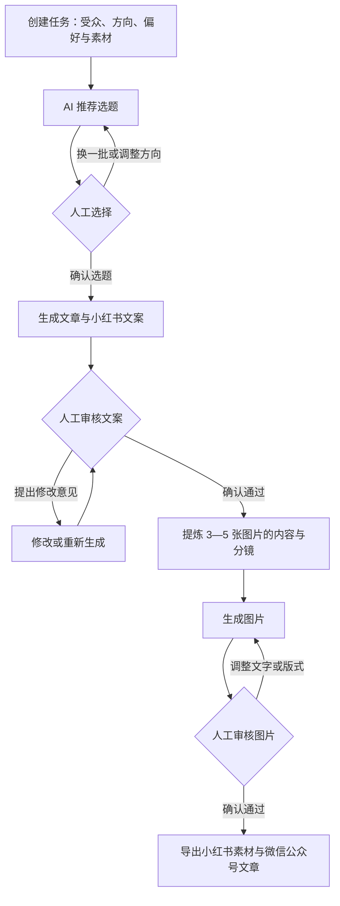

# AI 自媒体运营系统需求文档

- 版本：V0.1（需求初稿）
- 日期：2026-10-28
- 业务主体：AI 编程教育培训公司
- 技术方向：基于 LangGraph 1.0 编排内容生产与人工审核流程

## 1. 项目背景与目标

公司主营 AI 编程培训，涵盖 AI 应用开发、AI 训练师等方向。希望每天围绕目标用户感兴趣的问题，持续生产技术干货内容，服务小红书和微信公众号运营，提升内容生产效率、专业可信度和品牌认知。

系统以“一次选题、人工审核、双平台内容产出”为核心：先由 AI 提供多个选题供运营人员选择，再生成并反复审核文案；文案确认后，提炼为 3—5 张技术干货图片，同时保留适合微信公众号发布的完整文章。

## 2. 用户与职责

| 角色 | 职责 |
| --- | --- |
| 运营人员 | 提供内容方向与用户反馈、选择选题、提出修改意见、审核文案与图片、下载发布素材 |
| 内容审核人员 | 核查技术准确性、表达质量及品牌口径；初期可由运营人员兼任 |
| AI 系统 | 推荐选题、生成与修改文案、提炼图片内容、生成图片、保存任务与版本 |

目标受众初步包括 AI 编程入门者、希望转型 AI 应用开发的开发者，以及关注 AI 训练师技能的人群。各类人群的内容占比可配置。

## 3. 产品范围

### 3.1 首期必须实现

1. 创建每日内容任务，填写受众、方向、偏好及素材。
2. AI 推荐多个选题，由人工选择一个后继续。
3. AI 生成完整技术分享文章及小红书配套文案。
4. 文案支持人工审核、反馈、重新生成或局部修改，多轮确认后继续。
5. 基于已确认文案，提炼并生成 3—5 张图片。
6. 图片支持预览、修改和审核。
7. 输出小红书发布素材包与微信公众号文章，支持下载、复制。
8. 保存任务状态、内容版本、审核意见；中断后可恢复。

### 3.2 后续扩展

- 自动采集或接入平台表现数据，辅助选题与复盘。
- 每日定时创建任务、提醒待审核事项。
- 团队协作、角色权限、批量生产和内容日历。
- 对接平台发布能力，审核通过后发布并记录结果。

首期将“发布”定义为生成可人工发布的素材，不默认包含自动登录、自动发布或平台数据抓取。

## 4. 核心业务流程

人工未选择选题时，不生成正文；文案未审核通过时，不进入图片生成。图片内容必须基于审核通过的文案版本。

## 5. 功能需求

### 5.1 内容任务与偏好输入

- 每个任务记录日期、目标受众、内容方向、内容目标、参考素材及品牌要求。
- 内容方向包括 AI 应用开发、AI 训练师，可扩展细分类别。
- 用户偏好来源包括运营人员录入的高频问题、评论反馈、历史优秀内容、表现数据及参考资料。
- 无历史数据时，以目标受众和人工录入的需求作为选题依据，并明确标记为初始假设。
- 首期支持人工输入和粘贴资料；外部数据接入单独实施。

### 5.2 AI 选题推荐

- 默认每次生成 5 个选题，数量可配置。
- 每个选题包含标题、目标人群、用户痛点、核心知识点、推荐理由、建议内容形式和所需参考资料。
- 优先推荐可操作、可讲清楚、有明确学习收益的技术干货，避免空泛营销。
- 支持选择、换一批、修改方向、人工自定义选题。
- 参考近期已发布内容，提示重复或高度相似的选题。
- 无真实数据支撑时，不编造热度、互动量或用户偏好结论。

### 5.3 文案生成

选题确认后，生成以下内容：

| 产物 | 要求 |
| --- | --- |
| 完整技术文章 | 面向微信公众号，包含标题、导语、正文、示例、总结；默认约 1000 字，可配置 |
| 小红书配套文案 | 与图片主题一致，包含标题、简短说明和话题建议，适合人工复制发布 |
| 参考资料 | 记录技术信息来源及需人工核查的内容；没有来源时如实标记 |

- 文章以清晰、实用、易理解为主，匹配受众的知识水平。
- 涉及代码、命令、工具版本时，说明必要的使用前提，保证内容与示例一致。
- 技术事实需要可核查；无法确认的内容标记为待核查，不能伪造引用或验证结果。
- 品牌介绍与课程引导可配置，避免影响技术内容阅读。

### 5.4 人工审核与修改

- 展示文章、小红书文案及当前版本，支持人工直接编辑。
- 审核操作包括“通过”“提交修改意见”“重新生成”。
- 运营人员可指定修改某一段、调整语气、补充示例、改变长度或重写全文。
- AI 修改后产生新版本，保留旧版本和对应审核意见。
- 人工保存编辑不等于审核通过，必须明确确认后才能进入下一步。
- 审核可多轮进行，任务关闭前不限制正常修改轮数。
- 文案确认后再次修改，需重新确认；已有分镜、图片标记为过期，重新生成或重新审核后才能导出最终素材包。

### 5.5 图片内容提炼与生成

- 每个选题生成 3—5 张图，默认 4 张，允许人工调整。
- 图片为文章的精简表达，保留核心结论、关键步骤和必要示例，不机械分割全文。
- 建议结构：封面图、知识点或步骤图、示例图、总结图；按实际内容合并或拆分。
- 每张图记录顺序、标题、正文要点、版式和所属文案版本。
- 风格统一，支持品牌色、字体风格和标识配置；默认采用适合手机阅读的竖版设计，尺寸可配置。
- 图片中文清晰可读、无乱码、无文字裁切；代码和流程图应保证准确、易读。
- 实现方式需保证文字可控，可采用模板排版配合 AI 视觉素材，具体方案在技术设计中确定。
- 支持单张重新生成、调整文字与版式，不必每次重做整组图片。
- 生成失败时保留已成功的图片，允许重试失败项。

### 5.6 双平台导出

**小红书素材包：**

- 按发布顺序编号的 3—5 张 PNG 或 JPG 图片。
- 配套标题、正文及话题建议。
- 支持单张下载和整包下载。

**微信公众号文章：**

- 审核通过的完整标题与正文，支持 Markdown 导出及复制。
- 保留标题层级、列表和代码块等基础结构，便于后续排版。
- 微信文章与小红书图片保持知识点和结论一致，允许采用不同表达详略。

### 5.7 任务记录与恢复

- 展示任务列表、选题、创建时间、当前状态和待办审核环节。
- 记录模型调用结果、失败原因、审核记录及内容版本。
- 刷新、退出或服务重启后，可继续待选题、待审核或失败的任务。
- 重复点击确认、重试或恢复，不应造成重复任务和重复产物。

## 6. LangGraph 1.0 工作流需求

本节规定编排行为，不作为具体 API 用法或最终架构说明；实现时需核对 LangGraph 1.0 官方文档与依赖版本。

- 使用有状态工作流组织选题、正文生成、审核、图片生成和导出。
- 在选题选择、文案审核和图片审核环节暂停，等待人工输入后恢复执行。
- 使用持久化检查点保存流程状态，不能仅依赖进程内存。
- 修改意见驱动流程返回对应生成环节，审核通过后才允许推进。
- 长耗时图片任务提供进行中状态和失败重试，避免请求超时导致任务丢失。
- 内容生成与外部副作用分离，恢复执行时避免重复生成、重复扣费或重复导出记录。

建议任务状态：草稿、选题生成中、待选题、文案生成中、待文案审核、图片生成中、待图片审核、可导出、失败、已取消。历史产物的有效性需独立记录。

建议持久化数据：任务 ID、工作流标识、受众与偏好、候选选题、已选选题、文案版本、审核结论与意见、图片分镜、图片文件位置、产物来源版本、错误信息、创建与更新时间。

## 7. 页面需求

| 页面 | 核心内容 |
| --- | --- |
| 任务列表 | 今日及历史任务、状态、待审核入口、新建任务 |
| 任务配置 | 方向、受众、偏好、参考资料、篇幅、图片数量和品牌设置 |
| 选题选择 | 候选卡片、推荐依据、选择、换一批、自定义选题 |
| 文案审核 | 完整文章、小红书文案、编辑、修改意见、版本记录、确认按钮 |
| 图片审核 | 分镜与图片预览、单张修改、重新生成、整组确认 |
| 素材导出 | 小红书素材包、微信公众号正文、下载与复制 |

## 8. 非功能需求

- 生成过程显示明确状态与错误信息，人工等待期间无需保持页面常开。
- 模型、提示词、品牌配置可维护；记录生成使用的配置版本，便于追溯。
- API 密钥在服务端安全保存，不写入前端代码、公开仓库或导出素材。
- 内容和图片持久化存储，导出素材能关联对应任务与审核版本。
- 记录各任务模型用量、图片数量及可获得的成本数据；费用或配额不足时清晰提示。
- 不将未经人工确认的内容标记为最终发布素材。

## 9. 首期验收标准

1. 输入 AI 应用开发或 AI 训练师方向后，系统提供默认 5 个可供选择的选题。
2. 未确认选题时，流程停留在待选题状态；选择后生成文章与小红书配套文案。
3. 对文案连续提出两轮修改意见，系统均可生成新版本，并保留历史意见与内容。
4. 文案未确认时不能生成图片；确认后生成 3—5 张与文章一致的干货图片。
5. 可单独修改或重生成其中一张图片，其他已确认图片保留。
6. 修改已确认文案后，旧图片被标记为过期，不能直接作为最新最终素材导出。
7. 图片审核通过后，可下载有序图片及配套文案，并导出微信公众号 Markdown 文章。
8. 在人工审核阶段关闭页面或重启服务后，任务能够恢复并继续。
9. 模拟一次图片生成失败后，可重试失败项，已生成产物不丢失。
10. 重复提交同一次确认操作，不产生重复任务或重复推进流程。

## 10. 待细化事项与当前默认值

| 事项 | 当前默认值或处理方式 |
| --- | --- |
| 每日产量 | 每天 1 个选题任务，可人工增加 |
| 用户偏好数据 | 首期人工输入，后续接入真实表现数据 |
| 文案长度 | 默认约 1000 字，可配置 |
| 候选选题数量 | 默认 5 个 |
| 图片数量 | 默认 4 张，可选 3—5 张 |
| 发布方式 | 人工下载、复制后发布 |
| 审核角色 | 运营人员兼任，后续可拆分 |
| 模型与图片服务 | 待结合中文质量、稳定性、成本确定 |
| 品牌视觉 | 待提供品牌名称、标识、配色及参考风格 |
| 运行部署方式 | 待技术设计阶段确定 |

以上默认值用于推进首期设计，可在后续需求评审中调整。
