# 刘伟臣｜AI 应用开发工程师

## 个人介绍

刘伟臣　｜　17681172386　｜　17681172386@163.com

## 自我评价

毕业3年，技术出身，业务、运营、产品全懂  
前端、服务端、运维全懂  
精通Agent技术架构 & Ai团队管理  
老板要是想带着公司做 AI 转型，我们一起奋斗
啥都懂点，喜欢跟产品、运营坐一块儿聊业务
不对老板说不行，只给方案一二三

## 教育经历

南京林业大学　｜　软件工程　｜　本科　｜　2024 届

## 公司经历

### 江苏健汲网络科技有限公司｜私域渠道供货

**全栈开发 → AI 应用开发　｜　2024.08 至今**

公司为社群、私域直播和团购渠道供应保健品与滋补品，并提供商品资料和直播协作支持。全栈开发阶段围绕商品、SKU、包装版本和渠道素材开发后端接口、维护数据，并参与运营后台联调。AI 应用开发阶段基于商品资料和直播素材设计渠道导购 Agent、开发核心链路，用评测与监控中台支撑版本回归和上线验证。

1. **AI 应用架构与技术选型**　围绕社群商品咨询、团购支持和直播内容协作拆分知识检索、工具执行与业务编排。将商品、规格和可供库存查询封装为可复用工具，通过 MCP 统一接入 Agent，明确调用权限、超时与失败回退，便于业务扩展和问题追踪。
2. **商品知识治理与 RAG 检索**　统一品牌商品规格、包装版本、咨询记录和直播素材的关联方式。以 SKU 和版本约束检索范围，结合语义召回与重排处理模糊问法。遇到同名不同规格的商品，先确认具体款式，再引用对应资料，减少跨 SKU 串答和旧版说明误用。
3. **导购 Agent 与多模态应用**　将渠道需求澄清、商品筛选、规格比较和库存确认串成多轮咨询流程。用 LangGraph 编排内容生成与人工审稿，按商品编号将直播切片、字幕时间戳和商品包装图关联入库，使客服能从回答直接定位到对应的商品讲解片段。
4. **Agent 自动化评测与监控中台**　面向社群与团购商品咨询、工具调用和购物车状态设计自动化回归体系。使用 Python 状态快照与 Mock 数据库做确定性断言，由分级 LLM 裁判判断开放式回复。批量用例在可重置沙箱内执行，通过双层报告和单例 Trace 定位失败，接入 CI/CD 合入门禁，并将线上典型失败样本回补到评测集。
5. **模型优化与工程化交付**　将事实准确性、工具参数和话术风格纳入独立评测项，沉淀规格串答、缺货和渠道资料缺失等回归用例。用人工复核沉淀 SFT/DPO 样本，比较模型在不同咨询场景下的准确性、首字延迟和调用成本，为模型选型和版本发布提供依据。

#### AI 体系建设

作为电商公司的 AI 负责人，主导 AI 体系从零到一落地，建成 AI 数据中台。搭建基于 RAG 的实时语音客服、多模态素材中心、销售考核、直播切片和内容运营五大应用，完成大模型微调并接入客服。建设 Agent 评测中台、MCP 共享集群和 Harness 运行时，形成覆盖数据、模型、应用和评测的完整链路。

## 项目关系总览

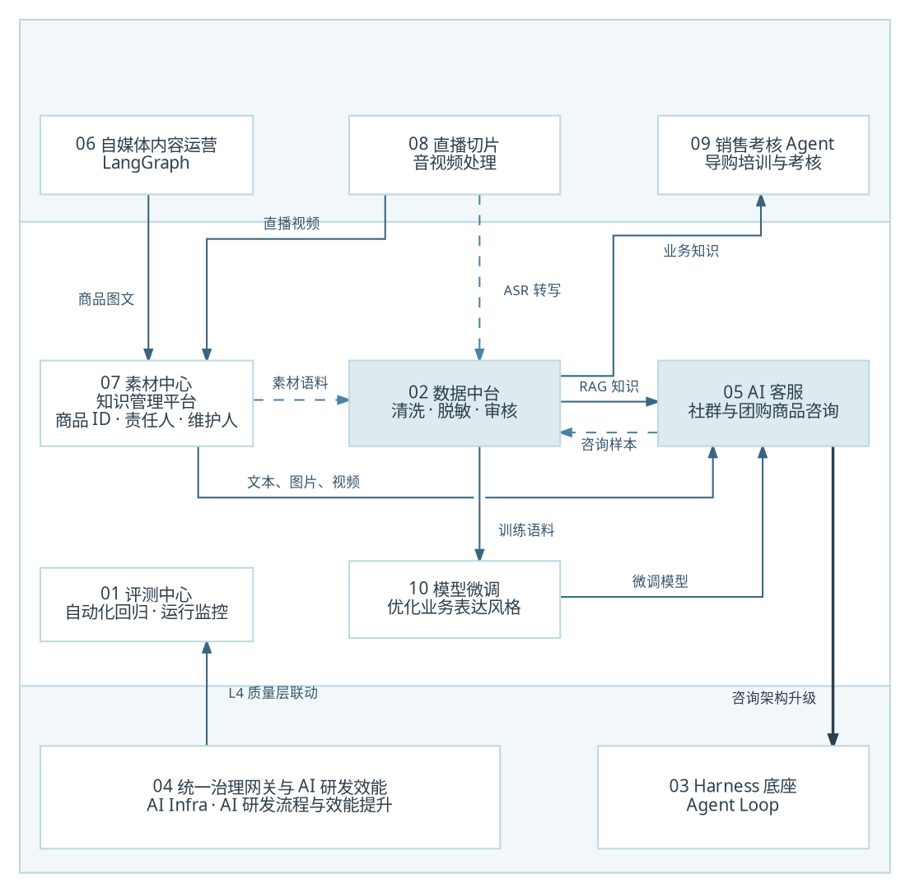

细实线表示数据或能力供给，深蓝粗实线表示架构升级，蓝色虚线表示反馈回流。

| 输入 | 处理 | 下游用途 |
|---|---|---|
| 社群与团购咨询对话 | 02 数据中台清洗、脱敏和审核 | 05 商品咨询、09 导购考核、10 模型微调 |
| 商品图文、私域直播回放 | 06 内容生成、08 直播切片 → 07 知识与素材中心 | 05 商品咨询按商品返回图片和视频 |
| 05 咨询中的工具调用和纠偏样本 | 03 Harness 执行与纠偏、01 自动化评测与监控中台 | 04 治理平台控制模型路由、执行权限与发布质量 |
| 02 审核后的训练语料 | 10 专属模型微调 | 05 接入微调模型，知识由 RAG 独立提供 |

### 项目一　Agent 自动化评测与监控中台

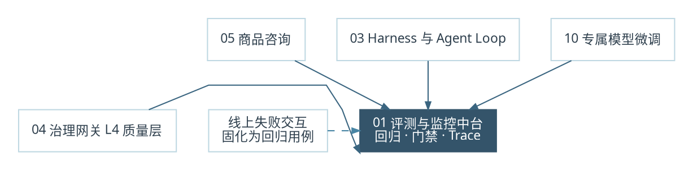

为保健品和滋补品渠道导购 Agent 提供离线评测、运行追踪与发布回归能力。将模型、提示词和工具调用的变更放到同一套业务用例中验证，并与项目四的质量治理层联动。

- **全链路评测体系**　评估任务成功率、工具调用精度、上下文记忆对齐、RAG 召回率、业务规则遵循、异常容错，以及成本、时延与安全合规。按业务场景查看各项结果，定位检索、模型判断或工具执行的具体问题。
- **混合判定引擎**　采用 80% 确定性代码断言和 20% LLM 裁判。用 Python 状态快照与 Mock 数据库校验工具参数和购物车操作前后的状态。按规则断言、轻量模型裁判、旗舰模型裁判三级处理，常规判定优先交给低成本环节。
- **批量调度与沙箱隔离**　使用 `runner.py` 递归扫描按业务模块分组的 100+ 用例，支持一键全量回归。为用例提供独立的 Mock 数据库与状态重置沙箱，保证重复执行时的初始条件一致。
- **双层报告与 Trace 追踪**　使用 `reporter.py` 生成 CI/CD 摘要，汇总通过率与失败分布。单例报告保留历史对话、工具调用和前后状态快照，便于追查商品规格串答、工具参数错误和购物车状态异常。
- **CI/CD 发布门禁**　将回归结果接入合入流程，要求核心安全用例 100% 通过。整体通过率低于设定阈值时自动拦截合入，避免模型或提示词变更引入业务回退。
- **线上失败样本回流**　将线上典型失败交互清洗后转成自动化用例，按「线上发现 → 固化用例 → 修复 → 回归验证」追踪，覆盖旧版包装资料误用、库存变化和商品资料缺失等咨询场景。

#### 线上失败样本回流

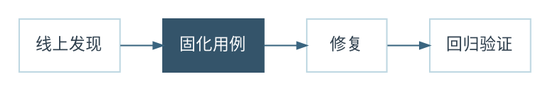

### 项目二　保健品与滋补品私域 AI 数据资产中台

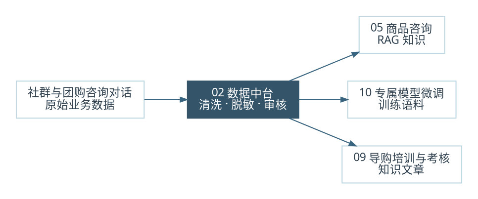

将微信社群和团购咨询的原始对话加工成可训练、可检索、可用于考核的数据资产，为项目五客服、项目十微调、项目九考核、项目七素材和项目八直播提供统一的数据来源。

- **对话抽取与去重**　设计 ETL → 原始库 → 暂存区 → 人工审核 → 多下游的全链路数据流水线：从微信本地 SQLite （MSG0-5.db + MicroMsg.db）抽取消息，完成通讯录 wxid →显示名映射、群消息发送者解析、时间过滤与 (session, timestamp,content) 去重后落 raw_chats 原始库（不可变）。
- **过滤与脱敏**　构建 DataFilter 内容过滤 + 脱敏引擎：按 9 级优先级分类（系统 / 媒体 / 过短 / 敏感 / 闲聊 / 垃圾 / 高价值）丢弃噪声，对手机号，身份证，银行卡，邮箱 , API Key 做正则脱敏；设计多层冗余脱敏（清洗时 + 写入时 + 导出时三次），并将价格脱敏设为硬红线，杜绝微调模型泄露真实定价。
- **会话切分与审核**　实现「一键清洗」对话块构建：基于 5 分钟时间窗切分会话、合并同角色连续消息、去重，并做自动预标注 （分类 / 质量分 / Q&A 提取 / 敏感标记）；高质量数据进 staging_conversations 暂存区，经人工 approve/reject/ 编辑后作为唯一可信数据源。
- **训练数据导出**　训练数据导出清洗（价格脱敏、风格修复、过短过滤、过长截断、占位符清理），一份数据多格式导出： ShareGPT / Alpaca / OpenAI JSONL （供项目十微调）与 RAG CSV （供项目五知识库），打通模型与数据的训练闭环。
- **知识库构建**　构建向量知识库下游：对 approved 数据做 embedding （DashScope text-embedding-v3）写入 knowledge_chunks，并经 LLM 提炼为结构化 knowledge_articles （场景 / 客户话术 / 推荐回复 / 置信度），同时为项目五的 RAG 检索和项目九的 AI 考核出题提供核心素材。
- **下游数据回流**　中台作为数据总线对接全业务：项目八直播切片的 ASR 转写结果回流入库留存，项目七素材中心的图片 / 视频反向补充多模态语料，真正实现 "AI 的一切都是数据 " 的闭环。

### 项目三　私域商品咨询的 Harness 与 Agent Loop 引擎

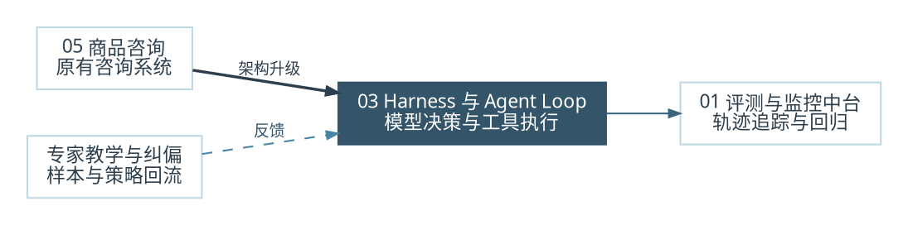

从零设计并实现模型无关、工具可插拔的 Agent 运行时底座（Harness），支持项目五在规格查询、资料查找、库存确认等私域售前场景中自主决策，并通过专家纠偏持续更新应答策略。参考 Claude Code 的架构，以通用循环和标准化工具承载不同咨询流程。

#### 一、 Harness 架构底座 : 模型无关、工具可插拔的 Agent 运行时

- **接口解耦**　双抽象 + 注册表解耦 : 以 LLMProvider 抽象隔离大模型、 Tool 抽象 + 注册表承载能力 ,Loop 引擎只依赖接口、与具体模型 / 工具零耦合，新增模型仅实现一个 chat() 适配器，新增能力仅登记一个 Tool, 业务与循环代码零改动。
- **模型适配**　模型热切换 : 配置驱动在「离线 Mock 桩」与「真实大模型」间一键切换—— Mock 保证 CI/ 演示可离线复现 , ARK 接入真实豆包，同一套 Loop 无差别运行。
- **调用协议**　标准化消息协议 : 内部统一采用 tool_call / tool_result 配对结构，与 OpenAI / Anthropic function calling 同构 , provider 层近乎零转换成本，可平滑接入任意兼容模型，相比早期自定义格式需在适配层伪造调用配对，重构后彻底消除该耦合。

#### 二、 Agent Loop 架构 : 模型自主决策的推理 - 行动循环

- **自主决策循环**　Model-driven 自主循环 : 实现 " 推理 → 工具选择 → 调用 → 观察 → 再决策 → 终止 " 闭环，决策权完全交给模型，意图识别隐式融入工具选择，去除独立意图分类模块——这正是 Claude Code 式 Agent 与传统 Workflow 的架构分水岭。
- **并行工具调用**　单步多工具并行 : 重构 LLMDecision 支持一步并行发起多个工具调用并批量回填观察结果， 提升复杂问题处理效率 ( 对齐主流模型的 parallel tool use)。
- **异常回填**　“错误即上下文”自纠错 : 工具异常 / 未知调用被捕获并转为 observation 回填，由模型自我纠正而非中断会话，显著提升鲁棒性。
- **运行边界**　确定性边界护栏 : 内置最大步数 + 超时双重限制防止死循环与失控，超限自动降级转人工，保证服务可预期。
- **链路追踪**　全链路可观测 : 结构化记录每一步 " 思考 - 调用 - 结果 "Trace，配合项目一（评测中台）支撑线上排障。

#### 三、 AI 自进化 : 示范学习 + 人在环自纠错闭环

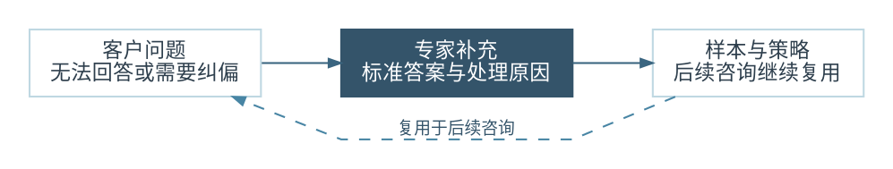

- **专家教学**　示范学习替代微调 : 业务专家以「问题 + 标准答案 + 套路原因」对话式教学 → 样本入库 → LLM 自动归纳 " 套路总纲 " → 注入系统提示词驱动真实回复。相比微调，轻量、可解释，更契合业务话术高频迭代。
- **相似意图**　语义泛化，举一反三 : 服务时召回全量样本交大模型语义精判，换问法 / 相似意图自动命中套路，未教过且无把握的问题自动转人工，守住事实红线。
- **规则合并**　状态合并 ( 可控进化 ): 套路总纲支持人工改写并持久化，重归纳时以人工版为基底增量融合新样本 ( 冲突以人工为准 ), 坚持单一数据源、杜绝规则漂移。
- **人工纠偏**　自纠错闭环 + 点评式教学 : 答不上 → 工单 → 专家补充 → 入库 → 下次答对，并支持实测中对回复提 " 纠偏意见 ", Agent 即时重答、满意后一键固化为样本并自动合并进总纲。
- **提示词优先级**　提示词分层治理 : 业务铁律 > 套路总纲 > 召回样本话术，分层拼装、优先级明确，约束团购报价等需严格校验的业务动作。

### 项目四　私域渠道 Agent 分层治理网关与 AI 研发效能提升

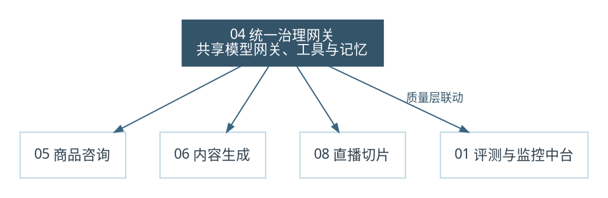

按分层图重构 AI 体系（为项目五、项目六、项目八等所有 AI 应用提供统一网关支撑）： L1 收供应商、 L2 收调用、 L3 收能力、 L4 收质量、 L5 收连接；并把同一套 " 验证左移 " 的方法论用于研发协作。

#### A. Agent 五层治理平台

- **供应商接入**　L1 供应商底座：确立 " 全量用云端 API、不自建 GPU" 决策并连同失效条件归档；建立供应商清单与主备双供组合，硬编码 API Key 全量收编进密钥库、路由层只持 secret_ref ——零部署。
- **网关路由**　L2 模型网关： N×M 直连收敛为沙漏，应用只留网关地址 + 虚拟 Key；逻辑模型名使换模型只改一行路由、应用零改造；三级配额 + RPM/ 月度双限 + 失败 3 次熔断；主链路零数据库查询。
- **工具与记忆**　L3 平台能力层：知识、工具中枢（模型只出意图、执行权永在平台， R1/R2/R3 分级）、记忆（结构化槽位永不裁剪，按 user_id 一键删除出报告）。
- **质量基础设施**　L4 质量基础设施：与项目一（评测中台）深度联动，实现评测集资产化 + RAG/ 模型 /Agent 三层评测 + 打分成本阶梯；四要素变更自动触发回归、按场景拆分对比基线，实测降本换模型总均分跌 3 分、投诉安抚场景跌 12 分，据此按场景分流模型，成本降 30% 且质量持平；护栏四道关（输入 / 检索 / 执行 / 输出）。
- **协议接入**　L5 协议层： MCP 通用服务、 A2A 连跨团队 Agent、 AG-UI 连人（双向事件流，人工确认在前端落地）、 A2UI 生成界面（白名单约束的结构描述，新增表单不占前端排期）。

#### B. Ai 研发工程效能提升

- **工程约定**　6. 上下文层：约定与禁区写入 AGENTS.md / .cursor/rules， SOP 写成 Agent 可执行 Skills，同仓同版本走 PR 演进；读者从 " 新员工 " 变成 " 每一个 Agent 会话 "，故人工维护并在 Retro 沉淀形成复利。
- **规格评审**　7. 意图层：确立 Propose → Apply → Verify → Archive 生命周期，评审对象从代码前移到 spec； spec 与实现同 PR ——人看意图与架构、 AI 校验实现一致性，增量 spec 归档进活规范库。
- **并行开发**　8. 执行层： git worktree 给每个 Agent 物理隔离目录；并行前强制三项独立性检查（文件互斥 / 接口稳定 / 范围有界）；验证得出瓶颈在任务切分而非 Agent 数量，甜蜜点单人 3 – 5 个。
- **合入门禁**　9. 门禁层：人评审 spec 与架构、 AI Reviewer 代码初审、自动化门禁全绿才有资格进人审；分支模型回摆 Trunk-Based；对 Agent 产品另建 Evals 即测试（prompt/ 评测集 / 脚本进 git，改 prompt 必跑回归），与 L4 共用评估底座。

### 项目五　保健品与滋补品私域售前咨询 Agent

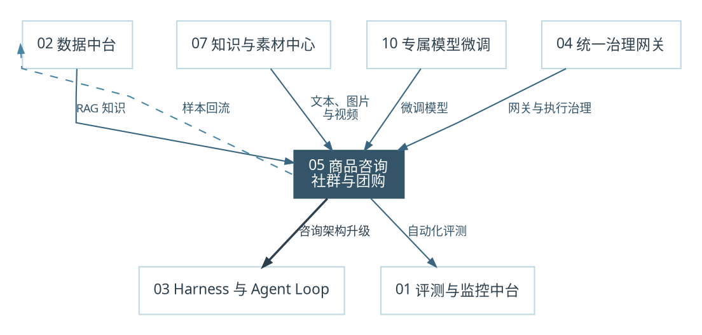

面向微信社群和团购售前场景，使用项目二（AI 数据中台）清洗后的咨询对话建立 RAG 知识库。智能客服支持实时语音对话，承接商品介绍、规格查询、库存确认和团购下单引导。

- **混合检索**　知识库直接消费项目二（AI 数据中台）导出的 RAG 数据，采用自定义标识符切片解决语义截断，应用 HNSW_HYBRID 混合检索 + Int8 量化，构建 Metadata 标签过滤机制，存储空间降低 75%。
- **图文视频应答**　深度联动项目七（多模态知识库与数字化素材管控中心），命中图片、视频等素材后以「文字 + 图片 + 视频」混排分条返回，让语音 / 图文客服具备多模态应答能力。
- **候选重排**　针对语音场景通过降维 + 精简 Limit 策略，引入 base-rerank 轻量模型，动态平衡 dense_weight 权重，在保持语义理解的同时显著提升专有名词命中率，检索速度提升 4 倍。
- **首字延迟**　极致优化 LLM 推理链路：固定 RAG 检索片段排序、合并 System Prompt 消息体，深度触发模型前缀缓存 （Prefix Caching）与 KV Cache，将复杂 RAG 场景的首字延迟（TTFT）从 15s 压缩至 2s 内；并结合项目四 （分层治理网关）做模型选型与资源池优先级调优。
- **实时语音**　深度优化 RTC 语音链路（ASR/TTS）：基于 ASR 实时捕获用户情感波动，配合 TTS 声音复刻实现情绪化回复；结合 FEC 前向纠错 + 自适应 Jitter Buffer，在 50% 高丢包环境下实现语音对话无感知恢复。
- **评测反馈**　基于 Prompt Pilot 管理提示词，协同项目一（评测中台）构建评测集实现自动化评分与版本对比；对负样本用智能优化算法做提示词重构，并将高质量样本回流项目二（AI 数据中台）沉淀，为项目十（微调工程）储备语料，保障回复准确性与一致性。
- **推理预算**　接入经项目十（专属微调工程）训练后的模型作为 LLM 层，通过缩短 system prompt 进一步降低 TTFT；并建立 Max Token 分级控制模型，按 95% 覆盖率边界动态配置推理 / 输出比例，提升单请求 Token 利用率。

### 项目六　私域内容运营与多阶段内容生成 Agent

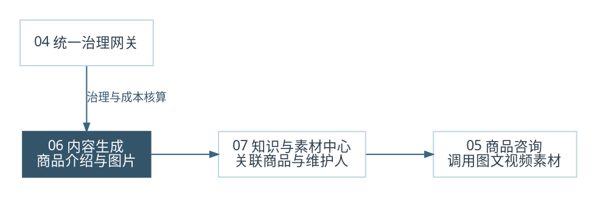

面向社群团购和私域直播协作，生成保健品与滋补品的商品图、商品介绍和推广文案，减少渠道运营团队的重复制作。生成的图片按商品关联至项目七（多模态素材中心），补充多模态知识库。

- **工作流与状态恢复**　基于 LangGraph 构建多阶段内容生成工作流，用 SubGraph 子图将选题、写作、配图拆为独立编排单元；通过 PostgreSQL Checkpointer 持久化状态，支持任意历史节点回滚与增量重试，将故障恢复粒度从整图细化到单节点。
- **成本核算**　设计 MetricsContext 上下文管理器做 LLM 全链路追踪，采集各节点 Token 消耗、推理延迟、错误率，结合项目四（分层治理平台）的定价模型完成成本核算，为模型选型提供数据支撑。
- **流式输出**　实现 SSE 流式输出与 LangGraph astream_events 深度集成，监听 on_chat_model_stream 捕获 Token 级实时流，配合前端 ReadableStream 将感知 TTFT 降低 60%，并保证流式 / 非流式下 Checkpointer 数据结构一致。
- **异步配图**　针对配图批量生成做异步并行优化： asyncio.gather + run_in_executor 将同步 API 封装为协程并发执行，引入指数退避重试（1s → 2s → 4s）应对服务抖动，整体生成耗时缩减 70%。
- **模型路由**　构建多模型动态路由：简单任务走轻量 Flash 模型、复杂任务走旗舰模型，配合 with_structured_output 做 Pydantic Schema 强约束，并用 JSON Mode + 手动解析解决结构化输出与 Token 统计不兼容问题，降低 40% 推理成本。
- **调试与追踪**　设计环境变量驱动的 Mock 开关体系（llm/image/checkpointer）解耦外部服务，配合 Swagger UI 可视化评测与 Ngrok 公网映射，将本地调试效率提升 3 倍；接入 LangSmith + structlog + request_id 实现全链路可观测， 问题定位从小时级压缩到分钟级。
- **服务稳定性**　基于 SlowAPI 接口限流 + 熔断降级 + /health 健康检查 + 优雅关闭保障容器化高可用；生成的商品图直接写入项目七（多模态素材中心），经离线增强后成为项目五（AI 客服）的多模态回复素材，形成 " 生成即沉淀 " 的闭环。

### 项目七　多模态知识库与商品素材管控中心

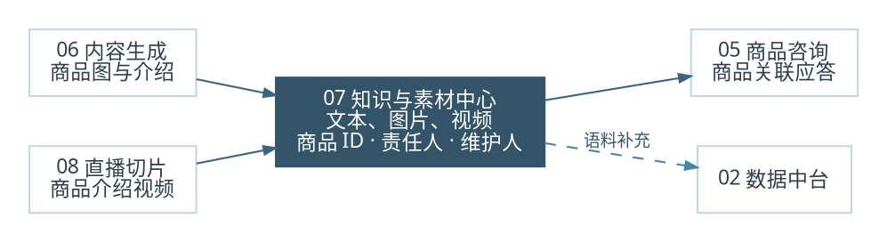

素材中心统一管理商品图、商品详情和私域直播讲解视频，为项目五（AI 客服）提供多模态回复素材，同时补充项目二（AI 数据中台）的多模态语料。中台导出的商品知识用于项目九（AI 销售考核）的出题和培训。

- **统一向量检索**　设计统一向量底座 rag_assets： text/image/video 三模态共用一张表（pgvector 1024 维 + HNSW vector_cosine_ops），一条 SQL 跨模态召回；核心理念是不向量化媒体本身，而向量化其「检索文本」 retrieval_text （" 这张图 / 视频能回答什么问题 "），与用户文本提问天然对齐。
- **人工入库**　实现人工即时命中（manual）路线：图片 / 视频上传时人工维护标题 / 描述 / 标签 / 分类，拼接为 retrieval_text 经 text-embedding-v3 入库即可被命中；隐私红线为命中返回打码版 TOS URL。
- **离线增强**　实现离线机器增强（enriched）路线：在同一行上用 OCR （RapidOCR） + VLM （qwen-vl） 补图片文字与看图描述、用 ASR + LLM 摘要补视频口播，人工内容在前、机器内容追加，重写 retrieval_text 并重新 embedding，召回相似度从 ~0.38 提升至 ~0.71；按 (source_table, source_id) UPSERT 幂等可反复回扫。
- **视频定位与混排**　设计长视频按 ASR 时间戳分段为多条 rag_assets， media_url 携带 #t= 秒数，命中后前端播放器直接跳转到精彩片段；统一应答按「文字必发、图≤ 3、视频≤ 1 」混排，阈值递增（text 0.35 < image 0.40 < video 0.42）。

### 项目八　私域直播切片与音视频处理 Agent

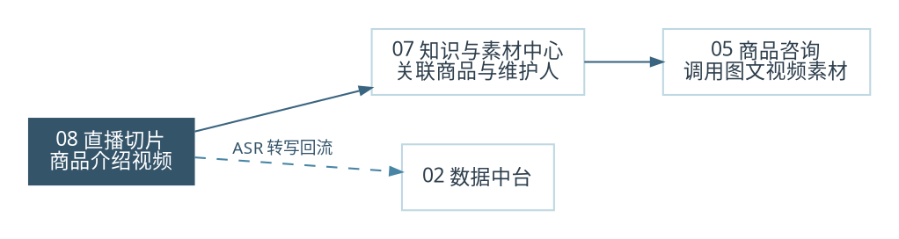

面向保健品与滋补品的私域直播协作，从回放中自动定位商品讲解和团购活动片段，生成切片标题与文案，减少人工逐段查找的工作量。ASR 转写结果回流项目二（AI 数据中台）留存复用。

- **切片流水线**　设计「视频 → AI 找精彩片段 → 输出短视频切片」端到端 Agent，三层架构： React 19 + FFmpeg.wasm 前端、 FastAPI + SQLAlchemy 2.0 后端、 Groq Whisper + DeepSeek 外部 AI。
- **浏览器提取音频**　关键设计浏览器内 FFmpeg.wasm 提音频：用 WORKERFS 零拷贝挂载源文件，转码为 16kHz/ 单声道 /64kbps MP3，把 2.5GB 视频压到 ~30MB 再上传，上传体积降低 99%，用户等待从分钟级降到秒级。
- **任务队列**　用 PostgreSQL 构建任务队列， API 写入 pending 秒回， Task Runner 后台协程每秒抢占一条串行执行 Pipeline，进程崩溃时启动自动重置「进行中」任务回 pending，实现零云依赖 + 崩溃可恢复。
- **进度与时间轴**　构建可观测 Pipeline （音频准备 → ASR → LLM 分析 → 切片 → 入库）：进度统一写库 + SSE 每秒读库推送，进度源唯一、断线可续、多端一致；长音频用 ffmpeg -c copy 按 25 分钟无损分段串行转录，时间戳加 offset 还原绝对时间轴。
- **长视频分析**　LLM 分析做按 ~6000 token 分批 + 双向重叠去重（重叠 >30% 取高分项），支撑 6 小时长视频不爆上下文；内置直播 / 面试 / 讲座场景化 Prompt，按场景切换切片时长与去重阈值；输出爆款分、推荐文案，并支持按需生成抖音风格标题与剪辑思路。
- **批量导出**　导出阶段二次复用 FFmpeg.wasm 在浏览器内按 AI 时间段批量裁切打包 ZIP，后端不碰重型转码； ASR 转写结果回写项目二（AI 数据中台）留存，为后续内容分析与项目十（微调训练）备用。

#### 进度与时间轴

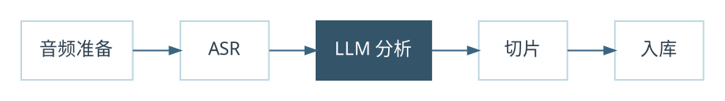

### 项目九　私域导购培训与智能考核 Agent

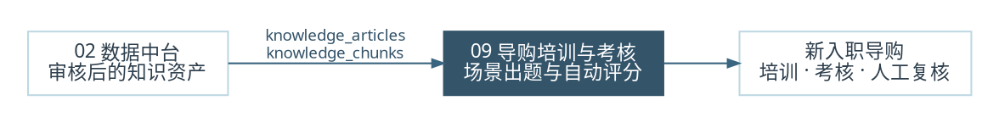

- **分级出题**　实现 LLM 自动出题：直接消费项目二（AI 数据中台）产出的 knowledge_articles/knowledge_chunks，按场景分类 + 置信度取素材，以「资深考官」角色（temperature 0.7）按简单 / 中等 / 困难生成商品介绍、规格解释和团购咨询等开放式场景题与参考答案，替代人工出题。
- **多维评分**　实现 LLM 自动评判：以「资深评审专家」角色（temperature 0.3 保稳定）从实战性、需求把握、销售策略、 话术自然度、红线检查五维度逐题打分，按「平均分 ×10 」映射百分制，支持人工二次复核校准。
- **知识库扩展**　针对知识库膨胀到十万级的演进，设计 RAG 出题方案：模糊请求先由 LLM 规划主题 → 多轮向量检索 （pgvector/Milvus）→ MMR 去重保多样性，解决固定 top-30 导致题目重复、长尾素材浪费的问题。

### 项目十　基于私域导购对话的销售模型微调

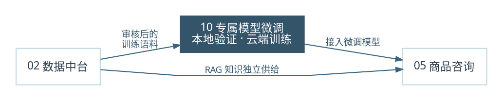

为使项目五（AI 客服）的应答贴近社群和团购导购的表达习惯，基于项目二（AI 数据中台）导出的 SFT/DPO 数据微调豆包模型，再接回项目五的客服链路。

- **训练与检索数据分流**　微调语料直接来自项目二（AI 数据中台）：消费中台 approved 的 ShareGPT/OpenAI 格式数据，并将对话分流为两套—— SFT 数据（保留多轮上下文学销售话术风格）与 RAG 知识库数据（提炼商品、价格、优惠等结构化知识），践行 " 微调管风格、 RAG 管知识 " 的职责分离，知识更新只改知识库无需重训。
- **本地验证与云端训练**　采用「本地小模型验证 + 云端大模型训练」两阶段策略：本地 LLaMA-Factory + Qwen2.5-3B-Instruct 做 QLoRA （rank=64, alpha=128, lr=2e-4），单卡 RTX 4090 约 40 分钟一轮快速验证数据质量；通过后上传火山引擎方舟对豆包 1.5 做生产级 LoRA （rank=32, lr=1e-5），按模型规模等比缩放超参，风格一致性人工盲评从 2.1 提升至 4.3 （5 分制）。
- **偏好对齐**　规划 SFT → DPO 两阶段训练路径： SFT 解决 " 从不会到会说 " 的风格模仿； DPO 对同一问题采样多条回复，由销售主管标注 chosen/rejected 偏好对训练优劣区分，解决 " 会说但说不好 "；选 DPO 而非 RLHF 是因其跳过奖励模型训练，在偏好数据有限（几百条）时更稳定、成本更低。
- **检索与重排**　构建 Embedding → 向量检索 → Rerank 三阶段 RAG Pipeline：火山引擎 Embedding 向量化 + 向量检索 top-20 粗召回，引入 Cross-Encoder 精排取 top-5，解决双编码器在语义相近文档上区分度不足问题，知识命中率从 72% 提升至 89%。
- **语音客服接入**　微调后的模型作为 LLM 层接入项目五 RTC 实时语音链路（客户语音 → ASR → RAG → 微调 LLM → TTS → 语音回复），通过微调缩短 system prompt 降低 TTFT，在实时对话场景下保障体验，完成 " 数据中台 → 微调 → 客服 " 的回路闭合。

#### 语音客服接入

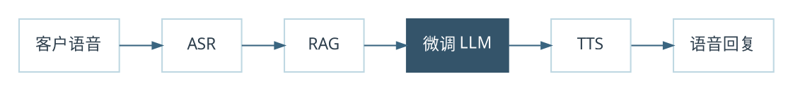
